<picture>

  

</picture>

[**GitHub**](https://github.com/aaryansingh200617-cyber) &nbsp;·&nbsp; [**LinkedIn**](https://www.linkedin.com/in/whitehat-aaryan/) &nbsp;·&nbsp; [**Portfolio**](https://aaryandev.web.app)

## About

I'm Aaryan Singh, a MERN stack developer. I build full-stack web applications, including data-driven platforms that bring AI into the product.

## Featured projects

**BRICSVue**
A real-time AI climate and pollution intelligence platform for the 11 BRICS nations. It combines satellite fire telemetry (NASA FIRMS), ground-station air quality (WAQI) and live weather data with a Gemini-powered copilot. It detects hidden pollution hotspots and forecasts air-quality spikes across major economic corridors.

**MindCheck**
A light-themed site that screens student depression risk from lifestyle and academic factors. It shows an instant, explained risk score and runs fully client-side.

## Stack

| Area | Technologies |
| --- | --- |
| Web fundamentals | HTML, CSS, JavaScript |
| MERN | MongoDB, Express, React, Node.js |
| Other | Python |

## GitHub activity

<picture>
  <source media="(prefers-color-scheme: dark)" srcset="https://github-readme-stats.vercel.app/api?username=aaryansingh200617-cyber&show_icons=true&theme=transparent&hide_border=true&title_color=22D3EE&text_color=CBD5E1&icon_color=7C3AED">
  
</picture>

## Connect

- GitHub: [aaryansingh200617-cyber](https://github.com/aaryansingh200617-cyber)
- LinkedIn: [whitehat-aaryan](https://www.linkedin.com/in/whitehat-aaryan/)
- Portfolio: [aaryandev.web.app](https://aaryandev.web.app)
